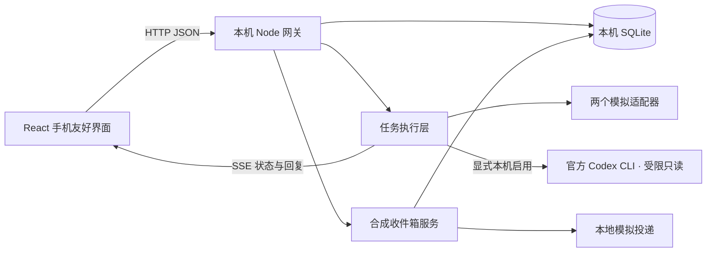
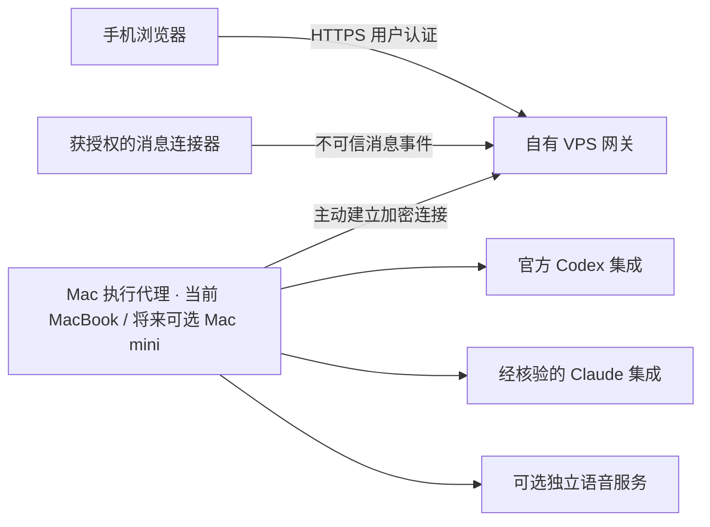

# 架构与阶段范围

## 当前：本地闭环与可选真实执行

当前在 MacBook 上开发与验证。未来可迁移到家庭环境中常开的 Mac mini；该设备尚未采购，迁移属于后续规划。

UI 不拼接 shell 命令。执行器接收结构化 Task、历史消息、取消信号和输出回调。每个会话固定适配器，同一会话只允许一个活动任务，避免上下文交错。真实 Codex 适配器需本机环境变量显式启用；启动配置仅说明可尝试调用，不保证账号模型可用。SQLite 保存会话、消息、任务和状态时间线；重启后将被中断的运行任务标为失败，保留等待用户确认的任务。

正常状态流为 `queued → running → completed / failed`。运行中的真实 CLI 收到取消后经过 `cancelling → cancelled`，无法确认停止则进入 `failed`。确认演示会经过 `running → awaiting_approval → running`，批准和取消由服务端校验，重复或过期操作返回冲突。浏览器通过 SSE 接收快照，重连时重新读取完整状态。

此阶段网关和执行代理处于同一 Node 进程。代码提供接口边界，尚未实现跨机器代理协议。界面「批准」只放行预先定义的模拟动作；它并不是未来真实工具审批的实现。

## 目标拓扑：之后才实施

保留通过自有服务器转发的需求，以下为对应的目标拓扑。远程访问的具体方式后续再选择；采用第三方隧道需要另行明确决定。部署、路由或 VPN 配置、常驻服务安装均尚未获得授权。

VPS 负责用户认证、设备配对、任务信箱和状态转发。Mac 主动连接 VPS，避免将本机执行服务直接暴露到公网。模型登录保持在官方支持的位置；VPS 不复制本机 OAuth、浏览器会话或 CLI 密钥文件。跨设备的审批需绑定任务、具体工具、参数摘要、有效期和幂等标识，拒绝宽泛的永久授权。

执行节点迁移前需验证会话与任务数据的备份、恢复，以及新机器上的官方登录与适配器配置。后续断线恢复需处理电脑休眠、网络中断和服务重启，核对任务状态并防止重复执行；未确认停止的真实任务继续沿用隔离与本机确认机制。

## 分阶段

| 阶段 | 范围 | 验收标准 |
| --- | --- | --- |
| v0.1 已实现 | 手机友好界面、SQLite、SSE、模拟适配器、取消与确认 | 本地完整流程和自动化测试通过；浏览器视觉验收仍受阻 |
| v0.2 已验证最小文本链路 | 官方 Codex exec 适配器、固定工作目录、受限权限、进程取消与脱敏错误 | CLI 0.162.1、现有 ChatGPT 登录、gpt-6-astra 已实际返回文本，经 HTTP/SSE 完成并保存；原生审批/恢复仍未验证 |
| v0.2 后续 | 原生 app-server 会话与工具审批；单独核验 Claude 合法接入 | 真实账户完成输入、状态和取消；工具审批单独设计与验证 |
| v0.3 当前 | 合成工作微信收件箱、按项目整理、回复预览与模拟发送 | 来源可核对；发送绑定不可变草稿与明确意图；去重、确认与未知结果阻塞通过本地验证；无真实微信连接 |
| v0.4 | 选定远程访问方式，经用户确认后部署自有服务器转发；认证、设备配对、主动连接、断线恢复与数据备份/恢复 | 真手机通过 HTTPS 操作；断线或重启后重试不重复执行；备份可恢复；丢失设备可撤销 |
| v0.5 | 核验正式支持的工作微信接入方式与权限；接通真实收件和经授权回复 | 原生账号、会话、消息 ID 稳定；外部内容不能变成执行指令；发送单独授权且有提供商结果证据 |
| 后续 | 可选迁移至家庭常开 Mac mini、多执行设备、TTS / ASR、通知偏好 | 验证数据迁移与官方登录；独立资源预算、清晰模型许可、可随时关闭 |

## 成熟组件的取舍

React / Vite 提供 UI 和开发工具；SQLite 提供持久化，避免为原型引入数据库服务。首版没有另行安装大型自动化或模型服务。在渠道和完整原生会话阶段，依据各组件官方文档评估 OpenClaw / n8n 等候选，是否试验另行决定，详见 [调研](integrations.md)。它们目前不是已确定的底座。Chatwoot 的客服收件箱、Open WebUI 的模型聊天、Open-LLM-VTuber 的语音角色各有用途，不能仅因有某个接口就承担整个工作平台。

GPT-SoVITS 是可选独立语音模块。此版本不下载或启动第三方音色、训练权重，不承诺任意电脑配置的实时性能，也不将其描述为当前 Codex 通话可直接导入的音色。

## 渠道接口

`ChannelAdapter.normalize()` 只产生标记为 `untrusted`、`replyAllowed: false` 的 ChannelEnvelope，不直接运行任务。v0.3 的收件箱采用 [独立消息契约](../shared/inbox.ts)：专用工作微信的合成消息进入本人收件箱，按原消息关联项目需求、期限、待办和待确认事项，保留来源链接；规则摘要与风险标签均为演示。

多 AI 项目及其执行适配层保留，本地网页为当前验证入口。后续可接入经核验的对话入口来整理消息和拟回复；本项目尚无已核验可用的 dot API 或真实微信收发能力，账号数量和转送关系仍待确认。本阶段暂停扩展微信专用前端，优先验证消息接入可靠性。

一个会话可以涉及多个项目，项目关联按原消息确认，不将群聊固定绑定到单一项目；回复目标仍绑定原消息的原会话。本版仅提供固定、已确认的合成关联与跨项目群聊样例，没有 AI 分类或确认 API。未来分类建议独立经历 `pending → confirmed / rejected`，不确定归属由用户确认；未确认建议不写入正式项目记录，分类确认也不授权发送。

回复先准备并预览不可变的目标、源消息和正文，再向对应 `replyId` 提交明确发送意图。高影响或敏感演示草稿还须显式确认。固定夹具重复加载不追加消息，通用入站事件按原生标识范围去重属于真实连接器前提。回复通过不可变 ID 和幂等 key 防止重复投递；同一源消息处于发送中或结果未知时，阻止另一草稿绕过限制发送。投递前先持久保存发送状态，重启后未确认的发送转为未知，本版不提供重试或解除未知接口。

普通讨论、整理和拟稿不授权发送；明确要求回复某人及具体内容，才形成相应目标范围的发送意图。当前 mock 仍通过页面明确点击确认模拟发送。

当前仅有合成数据与模拟投递，没有真实微信监听、dot 内部 API、QQ 接入或对外发送能力。真实连接需后续核验官方支持与权限，并取得授权；截图可见列表不能证明事件接口、消息全文或锁屏可靠性，也不构成实时保证。完整流程、结果语义和接入前提见 [消息收件箱设计](messaging-design.md)。

## 真实 Codex 适配器

当前采用短生命周期 `exec --json`，避免向网页开放原生 app-server 的全部 RPC。每次使用新临时会话，并在应用层重放本会话文本历史；不导入或恢复其他 Codex 线程，不读认证文件。完整助手消息写入 SQLite，经 SSE 传给前端。真实任务不支持 `approval-demo`；取消需确认进程退出。崩溃后停止未确认的任务会暂停真实适配器，并跨重启保留隔离，直到本机操作者核对进程并明确确认。实现与权限限制见 [真实集成设计](real-integration-design.md)。

后续计划迁移 app-server，以保留原生线程并桥接工具审批。当前 CLI 0.162.1 的最小文本链路已实际成功；旧客户端拒绝与升级后的证据均记录在验证文档中。这不等于原生审批、会话恢复、所有模型或所有账户均已验证。

下一步采用薄 `EngineDriver` 边界，优先官方 Codex App Server stdio，并保留未来 ACP 替换能力。现有会话、任务、消息、HTTP/SSE 与收件箱继续复用；第三方候选尚未安装或复制代码。具体映射、许可证和验证顺序见[日语 ADR](adr-harness-options.md)。
