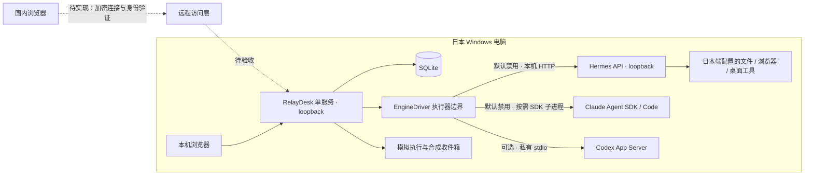

# 架构与执行边界

## 目标与当前范围

第一版面向一个用户从国内使用一台日本 Windows 电脑，同一时间只运行一个真实任务。RelayDesk 是任务控制台，Hermes、Claude Agent SDK 和 Codex 是分别启用的执行后端；每个会话固定执行器，不在异常时自动替换。

本轮只重整本地原型。远程认证、跨境路径、文件下载、截图回传、桌面操作与常驻恢复仍待实施和验收；Hermes 已安装或能对话不代表远程链路完成。



实线表示本地实现边界，不表示真实后端全部已验收。工具可用性取决于日本端配置；桌面、锁屏和具体软件须单独测试。Hub 按网络需要选用，只承担转发；第一版不拆独立 Runner、设备调度数据库或多层任务信箱。

## 职责与数据

| 层 | 职责 | 权威数据 |
| --- | --- | --- |
| 浏览器 | 输入、结果、具体一次审批、停止 | 不判断执行终态，不持有后端密钥 |
| RelayDesk | 准入、持久化、ID 映射、后端适配 | 本地任务 ID、意图、观察时间 |
| EngineDriver | 执行、审批响应、只读核对、关闭 | 将提供方回执转成状态，不伪造终态 |
| Hermes | 模型、工具、会话与运行 | session / run ID 和执行回执 |
| Claude SDK | 按需执行、工具审批、进程关闭 | SDK session ID、用户消息 UUID、匹配 result 与退出证据 |
| SQLite | 会话、消息、任务、有限活动 | 最近持久快照，不证明外部操作结果 |

`EngineDriver` 保留 `execute`、`decideApproval`、`recover`、`close` 边界。浏览器不能传可执行路径、工作目录、模型、凭据或任意方法名。会话固定执行器，失败后不静默切换后端。

Hermes 的 `Session.engineBinding.threadId` 保存 API session ID，`Task.nativeTurnId` 保存 run ID。字段沿用既有存储以兼容 Codex，不按展示名称或“最近一条任务”匹配。本地 task ID 是 Hermes 创建请求的幂等标识。ID 和意图在后续控制前持久化；写入失败时停止继续变更。

Claude 绑定包含真实 SDK session ID、固定 `.data/claude-native-workspace` 与驱动版本。发送前保存 SDK 用户消息 UUID 作为回合身份，结果须匹配；默认使用 SDK 自带 native CLI。独立 Code 登录通过官方流程验证，Desktop 登录不是证明，不从 Desktop 复制凭据。每个任务按需启动查询，结束后关闭；Desktop 可以继续日常使用。详见 [Claude 接入](claude-integration.md)。

## 准入、状态与断线

跨会话只允许一个真实任务。未确认停止或结果未知时保留阻塞；不因页面关闭、请求超时或服务重启释放执行能力。其他 Hermes 入口或人工桌面操作仍可能争用资源，不在 RelayDesk 的锁控制范围内。

```text
queued → running → completed / failed
             ↓
     awaiting_approval → running
             ↓
         cancelling → cancelled / completed / failed

执行结果无法确认 → unknown → 只读核对原任务
```

- `queued` 只说明本地已接收，不证明提供方开始。
- 真实终态决定完成、失败或取消；Hermes `interrupted` 按中断失败处理。
- 停止先进入 `cancelling`，请求收到不等于工作退出；已发生的操作不会被撤销。
- `unknown` 保留原任务及 session/run ID。只读核对后再更新；缺 ID 或不可读则继续待确认。
- 不重发 prompt，不更换 key 绕过未知，不自动解除 Hermes unknown，不按安静时长猜失败。
- SSE 重连读取快照，不重放提交、批准或停止；暂无活动只表示没有新事件。

Claude 当前恢复只读 SDK 历史；历史消息不能证明执行终态，因此仍保持 unknown，不会启动 resume 推理或解锁。需要后续持久终态回执和受控人工恢复，不能将最后一条助手消息当作完成。

Hermes 创建响应丢失且没有持久 run ID，是后续恢复设计的停止点，不能宣称端到端 exactly-once。提供方幂等有保留范围，跨密钥、跨配置或记录过期都不能视为永久去重。

## 审批

模拟批准只继续预定义演示。真实审批走原生专用接口，绑定任务、请求 ID、具体操作预览与执行代次。本地先存决定，再发送一次；重复、过期、错误任务或不完整请求拒绝。

Hermes 仅支持有具体 command/description 的普通工具请求的单次批准或拒绝；文件编辑审批没有完整差异预览，保持 unknown 并拒绝接受。缺少具体权限提示、未支持的澄清或旧协议不自动放行；不提供永久授权、批量批准或未知发送的重试。详见 [Hermes 接入](hermes-integration.md)。

Claude 默认不开放工具。可选工具配置仅提供逐次审批的 Read / Glob / Grep；Windows shell、目录转换与派生进程停止未经可靠验证，Bash、Edit、Write 明确禁用。工具限制和固定目录不是 OS 沙箱，SDK 禁用 hooks 的配置也不能屏蔽组织 managed hooks，需本机策略验收。

## 本地边界与远程前提

RelayDesk 固定 loopback 并校验 Host/Origin；Hermes 驱动只连本机 HTTP origin、不接受跳转。当前没有远程认证、访问撤销或审批身份，因此不能直接挂到反向代理或隧道。

远程阶段先选择国内可用路径，再完成身份验证、加密、撤销、限流和审计。若使用 Hub，日本端主动建连，中转不保存 Hermes API 密钥、CLI OAuth 或浏览器登录信息。断线恢复只核对原任务。

## 保留与后置

Codex、旧 exec、模拟聊天和合成收件箱保留，各自恢复规则不被替换。旧 exec ACK 不能解除 Hermes、Claude 或原生 Codex 未知状态。旧 Codex 验证是历史证据。

微信演示没有真实入口或发送能力；外部内容是数据，不构成执行或发送授权。多设备、多 AI 编排、自动消息回复、语音和复杂调度后置。见 [路线图](roadmap.md)。
