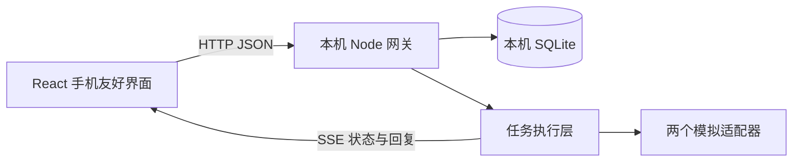
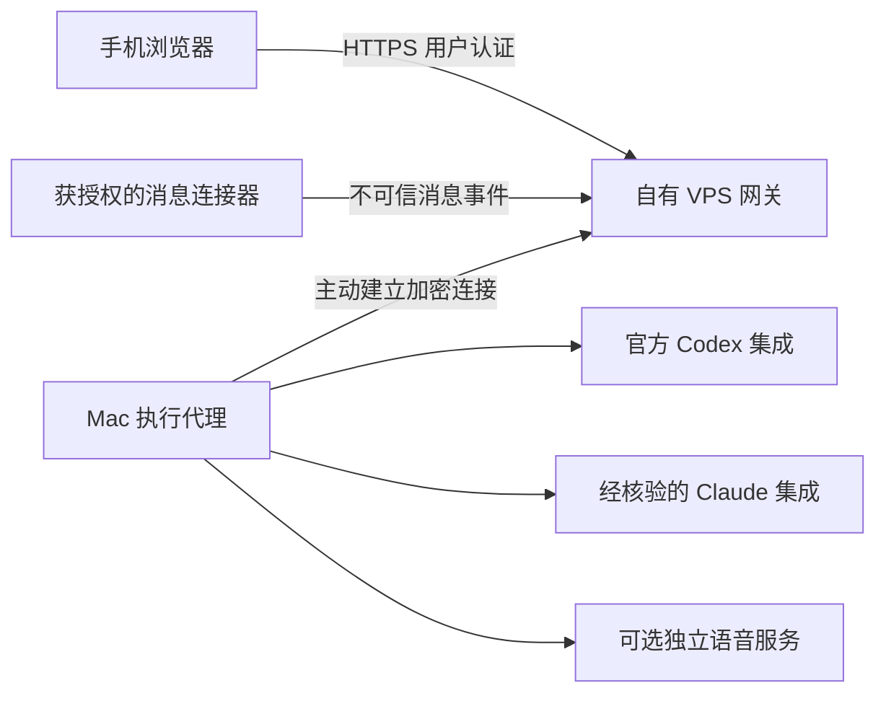

# 架构与阶段范围

## v0.1：已实现的本地闭环

UI 不拼接 shell 命令。执行器接收结构化 Task、历史消息、取消信号和输出回调。每个会话固定适配器，同一会话只允许一个活动任务，避免上下文交错。真实适配器默认不可选。SQLite 保存会话、消息、任务和状态时间线；重启后将被中断的运行任务标为失败，保留等待用户确认的任务。

状态流：`queued → running → completed / failed / cancelled`。确认演示会经过 `running → awaiting_approval → running`，批准和取消由服务端校验，重复或过期操作返回冲突。浏览器通过 SSE 接收快照，重连时重新读取完整状态。

此阶段网关和执行代理处于同一 Node 进程。代码提供接口边界，尚未实现跨机器代理协议。界面「批准」只放行预先定义的模拟动作；它并不是未来真实工具审批的实现。

## 目标拓扑：之后才实施

VPS 负责用户认证、设备配对、任务信箱和状态转发。Mac 主动连接 VPS，避免将本机执行服务直接暴露到公网。模型登录保持在官方支持的位置；VPS 不复制本机 OAuth、浏览器会话或 CLI 密钥文件。跨设备的审批需绑定任务、具体工具、参数摘要、有效期和幂等标识，拒绝宽泛的永久授权。

## 分阶段

| 阶段 | 范围 | 验收标准 |
| --- | --- | --- |
| v0.1 当前 | 手机友好界面、SQLite、SSE、模拟适配器、取消与确认 | 本地完整流程和自动化测试通过 |
| v0.2 | 官方 Codex 本地 app-server 试验；单独核验 Claude 合法接入；工作目录白名单 | 至少一个真实适配器完成输入、状态、取消和最小权限审批；不读取凭据文件 |
| v0.3 | 经用户确认后部署自有 VPS；认证、设备配对、主动连接、断线恢复 | 真手机通过 HTTPS 操作；重试不重复执行；丢失设备可撤销 |
| v0.4 | 选择一个正式支持的消息连接器；重要消息汇总、只读查看和回复草稿 | 渠道范围明确，外部内容不能变成执行指令，发送始终单独授权 |
| 后续 | TTS / ASR、通知偏好、多执行设备 | 独立资源预算、清晰模型许可、可随时关闭 |

## 成熟组件的取舍

React / Vite 提供 UI 和开发工具；SQLite 提供持久化，避免为原型引入数据库服务。首版没有另行安装大型自动化或模型服务。在渠道和真实代理阶段优先做官方 OpenClaw / n8n 等组件的集成试验，详见 [调研](integrations.md)。它们目前不是已确定的底座。Chatwoot 的客服收件箱、Open WebUI 的模型聊天、Open-LLM-VTuber 的语音角色各有用途，不能仅因有某个接口就承担整个工作平台。

GPT-SoVITS 是可选独立语音模块。此版本不下载或启动第三方音色、训练权重，不承诺任意电脑配置的实时性能，也不将其描述为当前 Codex 通话可直接导入的音色。

## 渠道接口

`ChannelAdapter.normalize()` 只产生标记为 `untrusted`、`replyAllowed: false` 的 ChannelEnvelope，不直接运行任务。将来「收件 → 摘要 → 建议操作 → 用户批准 → 发送」需要单独的可审计动作层；当前没有渠道监听器或对外发送能力。
